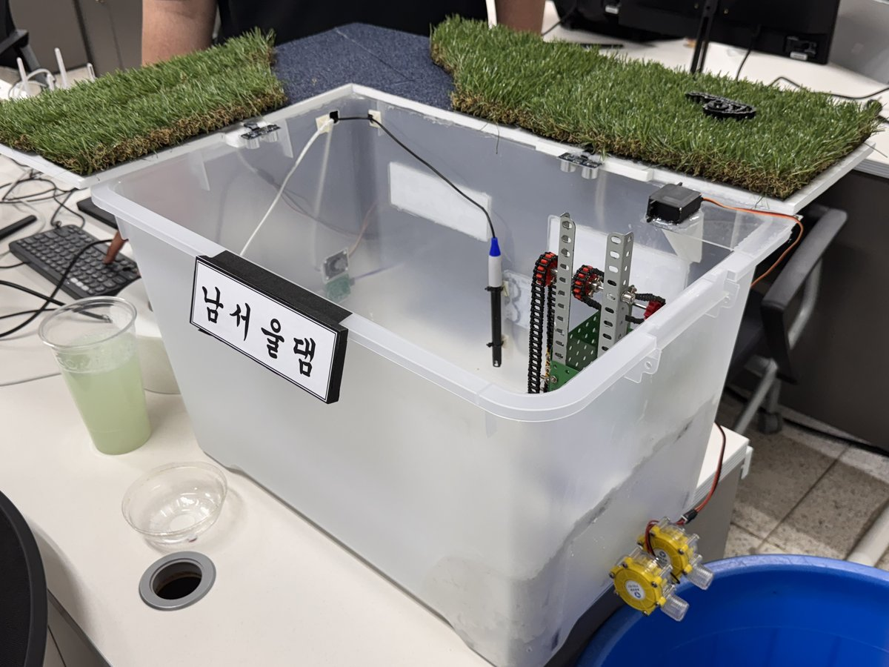
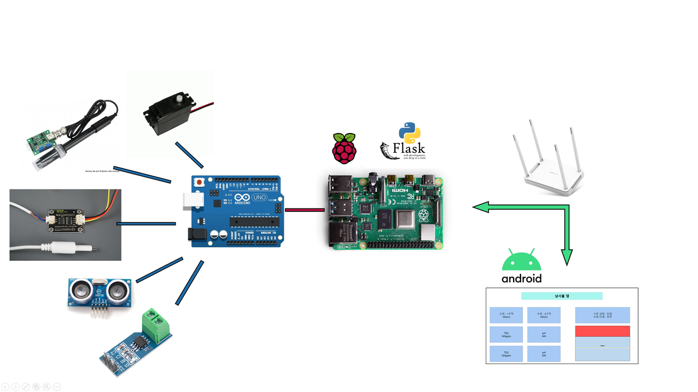
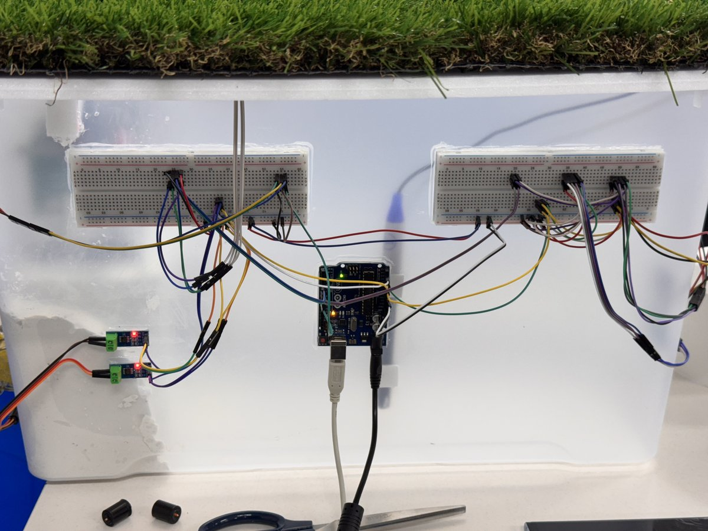
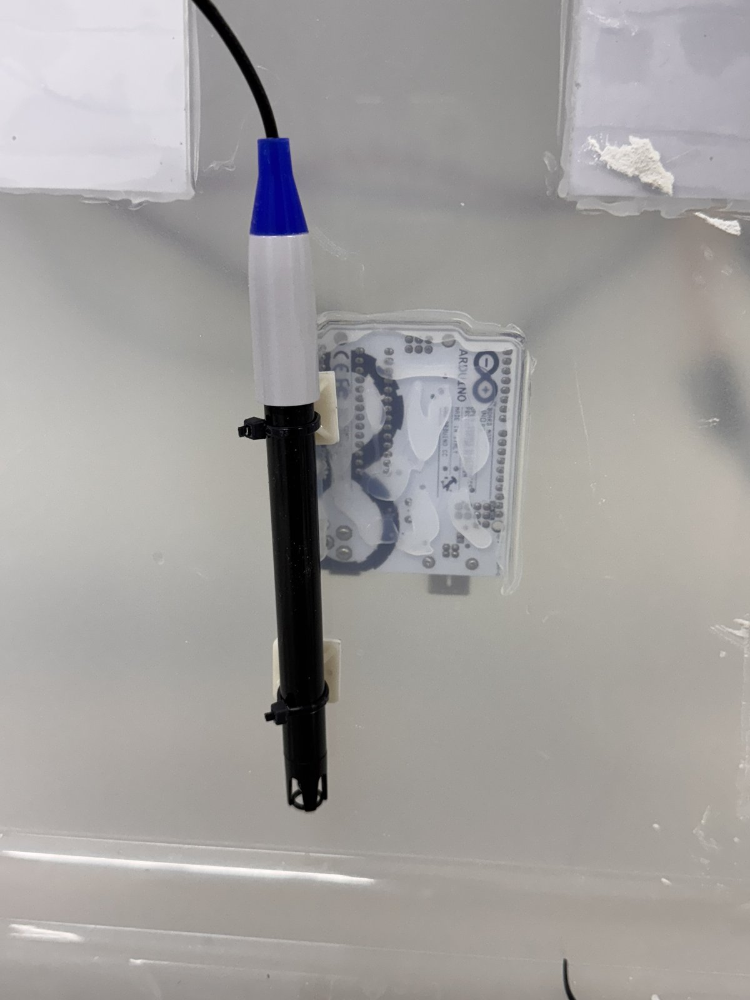

# Smart Dam Maintenance and Management System

수위·수질을 측정하고 수문을 자동으로 여닫는 IoT 소형 댐 관리 시스템입니다.
남서울대학교 지능정보통신공학과 졸업작품(2025)이며, 같은 주제로 졸업논문을 작성했습니다.

- 기간: 2025.02 ~ 2025.07
- 팀: 2인 (박민성, 임대균)
- 문서: [졸업논문](./docs/thesis.pdf) · [캡스톤 계획서](./docs/capstone-plan.pdf) · [전시 패널](./docs/panel.pdf)
  (공개본은 이메일·학번만 가렸고 본문은 원문 그대로입니다)

## 왜 만들었나

이상강우가 잦아지면서 댐의 수위와 수질을 함께 관리하는 일이 중요해졌습니다.
학과에서 따로 배운 임베디드 시스템(Arduino, Raspberry Pi)과 Android 앱을 하나의 시스템으로 묶어,
실제로 동작하는 하드웨어로 구현하는 것을 목표로 했습니다.

## 시스템 구성

    센서 (pH, TDS, 초음파 2개, 전류)
       ↓ 1초 주기 수집
    Arduino (센서 허브)
       ↓ USB 시리얼 (pySerial)
    Raspberry Pi (Flask 서버)
       ↓ Wi-Fi
    Android 앱 (모니터링, 경고, 수문 수동 제어)

| 구분 | 구성 |
|---|---|
| 댐 모형 | 높이 40cm, 용량 30L 플라스틱 수조. 내부 수문(서보모터 개폐), 측면 터빈 |
| 센서 | PH-4502C pH 센서, TDS Sensor Meter V1.0, 초음파 센서 2개, ACS712 전류 센서 |
| 제어·서버 | Arduino, Raspberry Pi, Flask (RESTful API), pySerial |
| 앱 | Android (실시간 모니터링, 경고 알림, 수문 수동 제어, 차트) |

### 자동 제어 규칙

| 수위 | 동작 |
|---|---|
| 15cm | 앱으로 경고 알림 |
| 18cm | 경고 알림 + 수문 강제 개방 |
| 10cm | 방류 후 수문 자동 폐쇄 |

자동 제어와 앱을 통한 수동 제어를 함께 지원합니다.

## 역할 분담

| 영역 | 담당 |
|---|---|
| 하드웨어 설계·제작 (댐 모형, 수문, 센서·터빈 배치) | 박민성 |
| Arduino·Raspberry Pi 코드, Flask 서버·통신 | 공동 |
| 실험 설계, 논문 작성 | 공동 |
| Android 앱 | 임대균 |

## 주요 판단과 문제 해결

### 1. Arduino를 센서 허브로 둔 이유

전류·TDS 센서는 아날로그 신호, 초음파·pH 센서와 서보모터는 디지털 신호를 씁니다.
Raspberry Pi가 아날로그 값을 직접 받으려면 MCP3002 같은 신호 변환기가 필요했습니다.
그래서 두 신호를 모두 받을 수 있는 Arduino를 센서 허브로 두고, Raspberry Pi는 서버 역할을 맡겼습니다.

### 2. pH·TDS 센서 간섭 (하드웨어, 박민성 담당)

- 문제: 두 센서의 측정 부위가 10cm 이하로 가까우면 TDS가 정상보다 200ppm, pH가 2 높게 측정됐습니다.
- 판단: 코드로 보정할 문제가 아니라 센서 사이의 물리적 거리 문제로 봤습니다.
- 조치: 두 센서를 서로 다른 벽면 중심 쪽으로 옮겨 20cm 이상 떨어뜨렸고, 정확한 값을 얻도록 개선했습니다.

### 3. 초음파 센서 2개 배치

위에서 수면까지의 거리를 재는 방식이라, 수면 위 이물질이나 주변 구조물이 값에 영향을 줄 수 있었습니다.
1번 센서는 수문과 간섭이 없는 수문 옆에, 2번 센서는 반대편 벽면에서 수질 센서와 겹치지 않는 위치에 최대한 멀리 두었습니다.

수위(cm) = 센서 설치 높이(cm) − 측정 거리(cm)

## 한계와 개선 방향

- 터빈 용량(5A)이 커서 30L 중 20L 이상을 방류해야 회전했습니다. 1~3A 저용량 터빈이 모형 규모에 맞습니다.

## 저장소 구성

    docs/    졸업논문, 캡스톤 계획서, 전시 패널 (이메일·학번 가린 공개본)
    images/  모형·구성도·배선 사진
